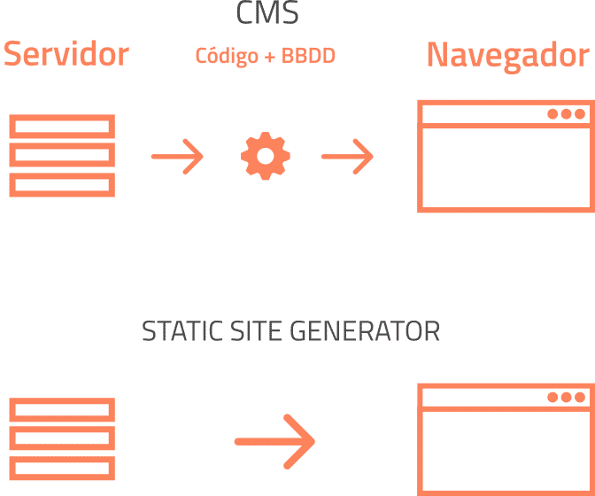

> # Gestor de contenido (CMS) #
Un CMS (Content Management System) o Gestor de Contenidos es un software que permite crear, administrar, organizar y publicar contenido en un sitio web de forma sencilla sin necesidad de saber programar. El contenido de un CMS se crea y administran a través de una interfaz gráfica intuitiva que separa el diseño visual del contenido y evita la necesidad de escribir código.

Los CMS se pueden clasificar según su uso o finalidad, su tipo de licencia y su arquitectura técnica:

 **SEGÚN SU ARQUITECTURA.**

 - Tradicional (Monolítico):  El backend y el frontend están unidos en la misma plataforma.
 - Sin cabeza (Headless): Se encarga de la gestión del contenido y lo expone mediante una API. 

 **SEGÚN SU PROPÓSITO.**

 - Genéricos/ Blogs/Webs corporativas.
    Ejemplo: WordPress y Joomla
 - Comercio electrónico.
    Ejemplo: Shopify y PrestaShop
 - Educación y aprendizaje.
    Ejemplo: Moodle y Canvas
 - Colaborativos y Wikis.
    Ejemplo: MediaWiki y Confluence
 -------------------------------
 ### Para saber más sobre CMS: ###

 [QUÉ ES UN SISTEMA DE GESTION DE CONTENIDO (CMS) EXPLICADO DE MANERA SIMPLE](https://www.youtube.com/watch?v=Aqbr1vje4fo)

 --------------------------------

 ## Tabla comparativa **CMS vs SSG** ##

 | Aspecto | CMS Dinámico | Generador estático |
 | ----- | ----- | ----- |
 | Forma de crear contenidos | A través de un panel de administración gráficos con editores visuales y formularios. | Escribiendo archivos de texto plano, principalmente en formato Markdown. |
 | Base de datos | Funciona en tiempo real. Se genera dinámicamente en el servidor cada vez que un usuario solicita la página. | Todo el HTML se precompila antes de subir el sitio al servidor. |
 | Generación del HTML | Funciona en tiempo real. Se genera dinámicamente en el servidor cada vez que un usuario solicita la página. | Todo el HTML se precompila antes de subir el sitio al servidor. |
 | Servidor necesario | Servidor con soporte para lenguajes de backend y gestor de base de datos. | Servidor web básico o plataformas de hosting estático (GitHub Pages, Netlify). |
 | Panel de administración | Incluye un panel de control accesible mediante usuario y contraseña. | Se administra desde el editor de código o terminal. |
 | Conocimientos técnicos | No se requieren conocimientos de programación para redactar o gestionar contenidos. | Requiere conocer Markdown, uso de terminal, controladores de versiones y conceptos de maquetación. |
 | Seguridad | Menor: Mayor superficie de ataque al tener base de datos, ejecución de código en servidor y vulnerabilidades en plugins. | Alta: Al no haber base de datos ni ejecución de scripts en backend, la superficie de ataque es prácticamente nula. |
 Rendimiento | Lento: Requiere tiempo para procesar consultas a la base de datos y ejecutar código de servidor en cada visita. | Muy alto: Sirve archivos HTML planos listos para consumir de forma inmediata. |
 | Actualización del contenido |  Tiene una actualización inmediata ya que se guarda desde el panel y se refleja al instante en la web. | Requiere recompilación. Hay que volver a ejecutar el proceso de build y desplegar los nuevos archivos HTML. |
 | Publicación | Guardar e instalar cambios mediante el panel CMS en el servidor. | Mediante un comando de compilación y subida de archivos. |
 | Ejemplos | WordPress, Joomla, Drupal, PrestaShop. | Jekyll, Hugo, Astro, Eleventy, Gatsby. |

 

[**Click aqui para saber sobre SSG ---->**](ssg.md)
